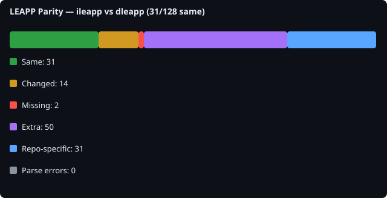

# LEAPP Parity Report

## Scan metadata

- **Generated**: 2026-10-12T20:32:39.648158+00:00
- **Baseline**: `ileapp`
- **Comparison**: `dleapp`

- **ileapp**: `d1846366757f` on `main` ([https://github.com/abrignoni/iLEAPP.git](https://github.com/abrignoni/iLEAPP.git))
- **dleapp**: `5c4af750acd9` on `main` ([https://github.com/abrignoni/DLEAPP.git](https://github.com/abrignoni/DLEAPP.git))

## Overall counts

| Metric | Count |
|---|---:|
| Files scanned (union) | 128 |
| Same | 31 |
| Changed (logic/file) | 14 |
| Missing from comparison | 2 |
| Extra in comparison | 50 |
| Expected repo-specific | 31 |
| Parse errors | 0 |
| Import dependency gaps | 12 |

## File-level summary

| Status | Count |
|---|---:|
| same | 31 |
| logic_changed | 14 |
| file_missing_from_comparison | 2 |
| file_extra_in_comparison | 50 |
| expected_repo_specific | 31 |

## Symbol-level summary

| Status | Count |
|---|---:|
| symbol_missing_from_comparison | 37 |
| symbol_extra_in_comparison | 22 |
| signature_changed | 2 |
| logic_changed | 43 |

## All compared files

128 file(s). See [details/file_list.md](details/file_list.md).

## Import dependency gaps

Baseline files that import modules missing from the comparison repo (for example `ilapfuncs.py` → `context.py`).

12 gap(s). See [details/import_dependency_gaps.md](details/import_dependency_gaps.md).

| Baseline file | Import | Missing in comparison |
|---|---|---|
| `main_entry.py` | `scripts.ios_keychain:report_supplied_keychain` | `scripts/ios_keychain.py` |
| `main_gui.py` | `scripts.tz_offset:tzvalues` | `scripts/tz_offset.py` |
| `scripts/blackboxprotobuf/__init__.py` | `scripts.blackboxprotobuf.lib.interface:*` | `scripts/blackboxprotobuf/lib/interface.py` |
| `scripts/blackboxprotobuf/lib/interface.py` | `scripts.blackboxprotobuf.lib.types.length_delim` | `scripts/blackboxprotobuf/lib/types/length_delim.py` |
| `scripts/blackboxprotobuf/lib/interface.py` | `scripts.blackboxprotobuf.lib.types.type_maps` | `scripts/blackboxprotobuf/lib/types/type_maps.py` |
| `scripts/blackboxprotobuf/lib/types/length_delim.py` | `scripts.blackboxprotobuf.lib.types` | `scripts/blackboxprotobuf/lib/types/__init__.py` |
| `scripts/blackboxprotobuf/lib/types/length_delim.py` | `scripts.blackboxprotobuf.lib.types:varint` | `scripts/blackboxprotobuf/lib/types/__init__.py` |
| `scripts/blackboxprotobuf/lib/types/type_maps.py` | `scripts.blackboxprotobuf.lib.types:fixed` | `scripts/blackboxprotobuf/lib/types/__init__.py` |
| `scripts/blackboxprotobuf/lib/types/type_maps.py` | `scripts.blackboxprotobuf.lib.types:length_delim` | `scripts/blackboxprotobuf/lib/types/__init__.py` |
| `scripts/blackboxprotobuf/lib/types/type_maps.py` | `scripts.blackboxprotobuf.lib.types:varint` | `scripts/blackboxprotobuf/lib/types/__init__.py` |
| `scripts/ccl_leveldb.py` | `scripts.ccl_simplesnappy` | `scripts/ccl_simplesnappy.py` |
| `scripts/unifiedlogs.py` | `scripts.log_filter:accelerate_query` | `scripts/log_filter.py` |

## Top mismatches

| Logical path | Status | Baseline file | Comparison file |
|---|---|---|---|
| `main_entry.py` | logic_changed | `ileapp.py` | `dleapp.py` | (9 symbol diffs)
| `main_gui.py` | logic_changed | `ileappGUI.py` | `dleappGUI.py` | (15 symbol diffs)
| `scripts/unifiedlogs.py` | logic_changed | `scripts/unifiedlogs.py` | `scripts/unifiedlogs.py` | (6 symbol diffs)
| `packaging/build.py` | logic_changed | `packaging/build.py` | `packaging/build.py` | (4 symbol diffs)
| `packaging/entrypoint.py` | logic_changed | `packaging/entrypoint.py` | `packaging/entrypoint.py` | (1 symbol diffs)
| `scripts/artifact_report.py` | logic_changed | `scripts/artifact_report.py` | `scripts/artifact_report.py` | (1 symbol diffs)
| `scripts/context.py` | logic_changed | `scripts/context.py` | `scripts/context.py` | (9 symbol diffs)
| `scripts/html_parts.py` | logic_changed | `scripts/html_parts.py` | `scripts/html_parts.py` |
| `scripts/ilapfuncs.py` | logic_changed | `scripts/ilapfuncs.py` | `scripts/ilapfuncs.py` | (31 symbol diffs)
| `scripts/lavafuncs.py` | logic_changed | `scripts/lavafuncs.py` | `scripts/lavafuncs.py` | (14 symbol diffs)
| `scripts/modules_to_exclude.py` | logic_changed | `scripts/modules_to_exclude.py` | `scripts/modules_to_exclude.py` |
| `scripts/report.py` | logic_changed | `scripts/report.py` | `scripts/report.py` | (1 symbol diffs)
| `scripts/search_files.py` | logic_changed | `scripts/search_files.py` | `scripts/search_files.py` | (12 symbol diffs)
| `scripts/version_info.py` | logic_changed | `scripts/version_info.py` | `scripts/version_info.py` | (1 symbol diffs)
| `scripts/log_filter.py` | file_missing_from_comparison | `scripts/log_filter.py` | `—` |
| `scripts/mmkv_parser.py` | file_missing_from_comparison | `scripts/mmkv_parser.py` | `—` |
| `scripts/bits_qmgr.py` | file_extra_in_comparison | `—` | `scripts/bits_qmgr.py` |
| `scripts/ccl/__init__.py` | file_extra_in_comparison | `—` | `scripts/ccl/__init__.py` |
| `scripts/ccl/ccl_blink_value_deserializer.py` | file_extra_in_comparison | `—` | `scripts/ccl/ccl_blink_value_deserializer.py` |
| `scripts/ccl/ccl_chromium_indexeddb.py` | file_extra_in_comparison | `—` | `scripts/ccl/ccl_chromium_indexeddb.py` |

## Changed logic files

14 file(s). See [details/changed_logic.md](details/changed_logic.md).

Preview

### `main_entry.py`
- module-level logic changed
- logic changed: `create_profile`
- logic changed: `main`
- only in dleapp: `profile_file_name` — `def profile_file_name(name)`
- only in dleapp: `read_profile` — `def read_profile(filename)`
- only in dleapp: `resolve_supplied_secret` — `def resolve_supplied_secret(value, label)`
- logic changed: `validate_args`
- only in ileapp: `version_readers_first` — `def version_readers_first(plugins)`
- only in dleapp: `write_profile` — `def write_profile(filename, plugins)`
### `main_gui.py`
- module-level logic changed
- logic changed: `ValidateInput`
- only in dleapp: `_update_signal_key_status` — `def _update_signal_key_status(*_args)`
- only in dleapp: `_update_threema_password_status` — `def _update_threema_password_status(*_args)`
- only in ileapp: `clear_keychain` — `def clear_keychain()`
- logic changed: `filter_modules`
- logic changed: `finish_crunch`
- logic changed: `load_profile`
- logic changed: `open_settings_window`
- only in dleapp: `open_signal_key_dialog` — `def open_signal_key_dialog()`
- only in dleapp: `open_threema_password_dialog` — `def open_threema_password_dialog()`
- logic changed: `pickModules`
- logic changed: `process`
- logic changed: `save_profile`
- only in ileapp: `select_keychain` — `def select_keychain()`
### `packaging/build.py`
- module-level logic changed
- logic changed: `appimage_desktop_entry`
- logic changed: `build_exe`
- logic changed: `hidden_imports`
- logic changed: `read_version`
### `packaging/entrypoint.py`
- module-level logic changed
- logic changed: `main`
### `scripts/artifact_report.py`
- module-level logic changed
- logic changed: `ArtifactHtmlReport.start_artifact_report`
### `scripts/context.py`
- module-level logic changed

## Missing files

2 file(s). See [details/missing_files.md](details/missing_files.md).

Preview

- `scripts/log_filter.py` (baseline: `scripts/log_filter.py`)
- `scripts/mmkv_parser.py` (baseline: `scripts/mmkv_parser.py`)

## Extra files

50 file(s). See [details/extra_files.md](details/extra_files.md).

Preview

- `leapp_functions/parsers/apple_atx.py` _(expected repo-specific)_ (comparison: `None`)
- `scripts/alternate_artifacts/appInventory.py` _(expected repo-specific)_ (comparison: `None`)
- `scripts/bits_qmgr.py` (comparison: `scripts/bits_qmgr.py`)
- `scripts/blackboxprotobuf/__init__.py` _(expected repo-specific)_ (comparison: `None`)
- `scripts/blackboxprotobuf/lib/__init__.py` _(expected repo-specific)_ (comparison: `None`)
- `scripts/blackboxprotobuf/lib/interface.py` _(expected repo-specific)_ (comparison: `None`)
- `scripts/blackboxprotobuf/lib/types/__init__.py` _(expected repo-specific)_ (comparison: `None`)
- `scripts/blackboxprotobuf/lib/types/fixed.py` _(expected repo-specific)_ (comparison: `None`)
- `scripts/blackboxprotobuf/lib/types/length_delim.py` _(expected repo-specific)_ (comparison: `None`)
- `scripts/blackboxprotobuf/lib/types/type_maps.py` _(expected repo-specific)_ (comparison: `None`)
- `scripts/blackboxprotobuf/lib/types/varint.py` _(expected repo-specific)_ (comparison: `None`)
- `scripts/ccl/__init__.py` (comparison: `scripts/ccl/__init__.py`)
- `scripts/ccl/ccl_blink_value_deserializer.py` (comparison: `scripts/ccl/ccl_blink_value_deserializer.py`)
- `scripts/ccl/ccl_bplist.py` _(expected repo-specific)_ (comparison: `None`)
- `scripts/ccl/ccl_chromium_indexeddb.py` (comparison: `scripts/ccl/ccl_chromium_indexeddb.py`)
- `scripts/ccl/ccl_leveldb.py` (comparison: `scripts/ccl/ccl_leveldb.py`)
- `scripts/ccl/ccl_segb1.py` _(expected repo-specific)_ (comparison: `None`)
- `scripts/ccl/ccl_segb2.py` _(expected repo-specific)_ (comparison: `None`)
- `scripts/ccl/ccl_simplesnappy.py` (comparison: `scripts/ccl/ccl_simplesnappy.py`)
- `scripts/ccl/ccl_v8_value_deserializer.py` (comparison: `scripts/ccl/ccl_v8_value_deserializer.py`)

## Expected repo-specific files

31 file(s).

## Parse errors

0 file(s). See [details/parse_errors.md](details/parse_errors.md).

Preview

_None._

## Signature changes

2 symbol(s). See [details/signature_changes.md](details/signature_changes.md).
