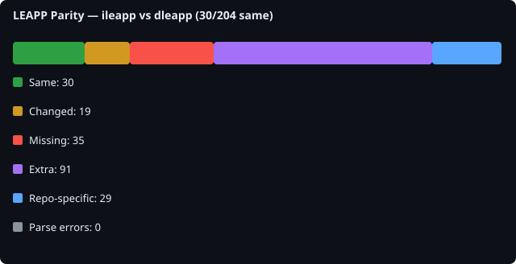

# LEAPP Parity Report

## Scan metadata

- **Generated**: 2026-11-23T23:01:28.850106+00:00
- **Baseline**: `ileapp`
- **Comparison**: `dleapp`

- **ileapp**: `62731d27b798` on `main` ([https://github.com/abrignoni/iLEAPP.git](https://github.com/abrignoni/iLEAPP.git))
- **dleapp**: `b812dfc6bcb1` on `main` ([https://github.com/abrignoni/DLEAPP.git](https://github.com/abrignoni/DLEAPP.git))

## Overall counts

| Metric | Count |
|---|---:|
| Files scanned (union) | 204 |
| Same | 30 |
| Changed (logic/file) | 19 |
| Missing from comparison | 35 |
| Extra in comparison | 91 |
| Expected repo-specific | 29 |
| Parse errors | 0 |
| Import dependency gaps | 105 |

## File-level summary

| Status | Count |
|---|---:|
| same | 30 |
| logic_changed | 19 |
| file_missing_from_comparison | 35 |
| file_extra_in_comparison | 91 |
| expected_repo_specific | 29 |

## Symbol-level summary

| Status | Count |
|---|---:|
| symbol_missing_from_comparison | 75 |
| symbol_extra_in_comparison | 60 |
| signature_changed | 4 |
| logic_changed | 39 |

## All compared files

204 file(s). See [details/file_list.md](details/file_list.md).

## Import dependency gaps

Baseline files that import modules missing from the comparison repo (for example `ilapfuncs.py` → `context.py`).

105 gap(s). See [details/import_dependency_gaps.md](details/import_dependency_gaps.md).

| Baseline file | Import | Missing in comparison |
|---|---|---|
| `leapp_functions/app/gui/app_state.py` | `leapp_functions.app.disk:FILE` | `leapp_functions/app/disk.py` |
| `leapp_functions/app/gui/app_state.py` | `leapp_functions.app.disk:FOLDER` | `leapp_functions/app/disk.py` |
| `leapp_functions/app/gui/app_state.py` | `leapp_functions.app.disk:MISSING` | `leapp_functions/app/disk.py` |
| `leapp_functions/app/gui/app_state.py` | `leapp_functions.app.disk:PENDING` | `leapp_functions/app/disk.py` |
| `leapp_functions/app/gui/app_state.py` | `leapp_functions.app.disk:SILENT` | `leapp_functions/app/disk.py` |
| `leapp_functions/app/gui/app_state.py` | `leapp_functions.app.disk:ask` | `leapp_functions/app/disk.py` |
| `leapp_functions/app/gui/app_state.py` | `leapp_functions.app.disk:path_status` | `leapp_functions/app/disk.py` |
| `leapp_functions/app/gui/app_state.py` | `leapp_functions.app.unlock:UNLOCKERS` | `leapp_functions/app/unlock.py` |
| `leapp_functions/app/gui/app_state.py` | `leapp_functions.app.unlock:Unlock` | `leapp_functions/app/unlock.py` |
| `leapp_functions/app/gui/artifacts.py` | `leapp_functions.app.artifact_list:by_title` | `leapp_functions/app/artifact_list.py` |
| `leapp_functions/app/gui/artifacts.py` | `leapp_functions.app.artifact_list:group_by_category` | `leapp_functions/app/artifact_list.py` |
| `leapp_functions/app/gui/artifacts.py` | `leapp_functions.app.artifact_list:load_profile` | `leapp_functions/app/artifact_list.py` |
| `leapp_functions/app/gui/artifacts.py` | `leapp_functions.app.artifact_list:profile_artifacts` | `leapp_functions/app/artifact_list.py` |
| `leapp_functions/app/gui/artifacts.py` | `leapp_functions.app.artifact_list:profile_for_report` | `leapp_functions/app/artifact_list.py` |
| `leapp_functions/app/gui/artifacts.py` | `leapp_functions.app.artifact_list:search` | `leapp_functions/app/artifact_list.py` |
| `leapp_functions/app/gui/artifacts.py` | `leapp_functions.app.artifact_list:toggle` | `leapp_functions/app/artifact_list.py` |
| `leapp_functions/app/gui/artifacts.py` | `leapp_functions.app.artifact_list:write_profile` | `leapp_functions/app/artifact_list.py` |
| `leapp_functions/app/gui/artifacts.py` | `leapp_functions.app.gui.custom_widgets:Caption` | `leapp_functions/app/gui/custom_widgets.py` |
| `leapp_functions/app/gui/artifacts.py` | `leapp_functions.app.gui.custom_widgets:Card` | `leapp_functions/app/gui/custom_widgets.py` |
| `leapp_functions/app/gui/artifacts.py` | `leapp_functions.app.gui.custom_widgets:Field` | `leapp_functions/app/gui/custom_widgets.py` |
| `leapp_functions/app/gui/artifacts.py` | `leapp_functions.app.gui.custom_widgets:GAP` | `leapp_functions/app/gui/custom_widgets.py` |
| `leapp_functions/app/gui/artifacts.py` | `leapp_functions.app.gui.custom_widgets:LabeledEntry` | `leapp_functions/app/gui/custom_widgets.py` |
| `leapp_functions/app/gui/artifacts.py` | `leapp_functions.app.gui.custom_widgets:OutlineButton` | `leapp_functions/app/gui/custom_widgets.py` |
| `leapp_functions/app/gui/artifacts.py` | `leapp_functions.app.gui.custom_widgets:SIDE_WIDTH` | `leapp_functions/app/gui/custom_widgets.py` |
| `leapp_functions/app/gui/artifacts.py` | `leapp_functions.app.gui.custom_widgets:open_menu` | `leapp_functions/app/gui/custom_widgets.py` |
| `leapp_functions/app/gui/artifacts.py` | `leapp_functions.app.gui.custom_widgets:show_example` | `leapp_functions/app/gui/custom_widgets.py` |
| `leapp_functions/app/gui/case.py` | `leapp_functions.app.gui.app_state:CASE_KEYS` | `leapp_functions/app/gui/app_state.py` |
| `leapp_functions/app/gui/case.py` | `leapp_functions.app.gui.custom_widgets:Caption` | `leapp_functions/app/gui/custom_widgets.py` |
| `leapp_functions/app/gui/case.py` | `leapp_functions.app.gui.custom_widgets:Card` | `leapp_functions/app/gui/custom_widgets.py` |
| `leapp_functions/app/gui/case.py` | `leapp_functions.app.gui.custom_widgets:Field` | `leapp_functions/app/gui/custom_widgets.py` |
| `leapp_functions/app/gui/case.py` | `leapp_functions.app.gui.custom_widgets:FileField` | `leapp_functions/app/gui/custom_widgets.py` |
| `leapp_functions/app/gui/case.py` | `leapp_functions.app.gui.custom_widgets:GAP` | `leapp_functions/app/gui/custom_widgets.py` |
| `leapp_functions/app/gui/case.py` | `leapp_functions.app.gui.custom_widgets:LabeledEntry` | `leapp_functions/app/gui/custom_widgets.py` |
| `leapp_functions/app/gui/case.py` | `leapp_functions.app.gui.custom_widgets:OutlineButton` | `leapp_functions/app/gui/custom_widgets.py` |
| `leapp_functions/app/gui/case.py` | `leapp_functions.app.gui.custom_widgets:two_columns` | `leapp_functions/app/gui/custom_widgets.py` |
| `leapp_functions/app/gui/case.py` | `leapp_functions.app.gui.custom_widgets:wrap_to_width` | `leapp_functions/app/gui/custom_widgets.py` |
| `leapp_functions/app/gui/results.py` | `leapp_functions.app.gui.custom_widgets:Card` | `leapp_functions/app/gui/custom_widgets.py` |
| `leapp_functions/app/gui/results.py` | `leapp_functions.app.gui.custom_widgets:OutlineButton` | `leapp_functions/app/gui/custom_widgets.py` |
| `leapp_functions/app/gui/results.py` | `leapp_functions.app.gui.custom_widgets:mark_line` | `leapp_functions/app/gui/custom_widgets.py` |
| `leapp_functions/app/gui/results.py` | `leapp_functions.app.gui.custom_widgets:open_menu` | `leapp_functions/app/gui/custom_widgets.py` |
| `leapp_functions/app/gui/results.py` | `leapp_functions.app.gui.custom_widgets:two_columns` | `leapp_functions/app/gui/custom_widgets.py` |
| `leapp_functions/app/gui/results.py` | `leapp_functions.app.gui.custom_widgets:wrap_to_width` | `leapp_functions/app/gui/custom_widgets.py` |
| `leapp_functions/app/gui/review.py` | `leapp_functions.app.gui.app_state:SECRETS` | `leapp_functions/app/gui/app_state.py` |
| `leapp_functions/app/gui/review.py` | `leapp_functions.app.gui.app_state:is_waiting` | `leapp_functions/app/gui/app_state.py` |
| `leapp_functions/app/gui/review.py` | `leapp_functions.app.gui.artifacts:unknown_text` | `leapp_functions/app/gui/artifacts.py` |
| `leapp_functions/app/gui/review.py` | `leapp_functions.app.gui.custom_widgets:Caption` | `leapp_functions/app/gui/custom_widgets.py` |
| `leapp_functions/app/gui/review.py` | `leapp_functions.app.gui.custom_widgets:Card` | `leapp_functions/app/gui/custom_widgets.py` |
| `leapp_functions/app/gui/review.py` | `leapp_functions.app.gui.custom_widgets:GAP` | `leapp_functions/app/gui/custom_widgets.py` |
| `leapp_functions/app/gui/review.py` | `leapp_functions.app.gui.custom_widgets:mark_line` | `leapp_functions/app/gui/custom_widgets.py` |
| `leapp_functions/app/gui/review.py` | `leapp_functions.app.gui.custom_widgets:two_columns` | `leapp_functions/app/gui/custom_widgets.py` |
| `leapp_functions/app/gui/review.py` | `leapp_functions.app.gui.custom_widgets:wrap_to_width` | `leapp_functions/app/gui/custom_widgets.py` |
| `leapp_functions/app/gui/run.py` | `leapp_functions.app.gui.custom_widgets:Card` | `leapp_functions/app/gui/custom_widgets.py` |
| `leapp_functions/app/gui/run.py` | `leapp_functions.app.run_worker:RunWorker` | `leapp_functions/app/run_worker.py` |
| `leapp_functions/app/gui/settings.py` | `leapp_functions.app.gui.custom_widgets:Caption` | `leapp_functions/app/gui/custom_widgets.py` |
| `leapp_functions/app/gui/settings.py` | `leapp_functions.app.gui.custom_widgets:Card` | `leapp_functions/app/gui/custom_widgets.py` |
| `leapp_functions/app/gui/settings.py` | `leapp_functions.app.gui.custom_widgets:GAP` | `leapp_functions/app/gui/custom_widgets.py` |
| `leapp_functions/app/gui/settings.py` | `leapp_functions.app.gui.custom_widgets:MARGIN` | `leapp_functions/app/gui/custom_widgets.py` |
| `leapp_functions/app/gui/settings.py` | `leapp_functions.app.gui.custom_widgets:OutlineButton` | `leapp_functions/app/gui/custom_widgets.py` |
| `leapp_functions/app/gui/source.py` | `leapp_functions.app.disk:FILE` | `leapp_functions/app/disk.py` |
| `leapp_functions/app/gui/source.py` | `leapp_functions.app.disk:PENDING` | `leapp_functions/app/disk.py` |
| `leapp_functions/app/gui/source.py` | `leapp_functions.app.disk:SILENT` | `leapp_functions/app/disk.py` |
| `leapp_functions/app/gui/source.py` | `leapp_functions.app.disk:path_status` | `leapp_functions/app/disk.py` |
| `leapp_functions/app/gui/source.py` | `leapp_functions.app.gui.app_state:SECRETS` | `leapp_functions/app/gui/app_state.py` |
| `leapp_functions/app/gui/source.py` | `leapp_functions.app.gui.app_state:WAITING` | `leapp_functions/app/gui/app_state.py` |
| `leapp_functions/app/gui/source.py` | `leapp_functions.app.gui.custom_widgets:Caption` | `leapp_functions/app/gui/custom_widgets.py` |
| `leapp_functions/app/gui/source.py` | `leapp_functions.app.gui.custom_widgets:Card` | `leapp_functions/app/gui/custom_widgets.py` |
| `leapp_functions/app/gui/source.py` | `leapp_functions.app.gui.custom_widgets:Field` | `leapp_functions/app/gui/custom_widgets.py` |
| `leapp_functions/app/gui/source.py` | `leapp_functions.app.gui.custom_widgets:FileField` | `leapp_functions/app/gui/custom_widgets.py` |
| `leapp_functions/app/gui/source.py` | `leapp_functions.app.gui.custom_widgets:GAP` | `leapp_functions/app/gui/custom_widgets.py` |
| `leapp_functions/app/gui/source.py` | `leapp_functions.app.gui.custom_widgets:LabeledEntry` | `leapp_functions/app/gui/custom_widgets.py` |
| `leapp_functions/app/gui/source.py` | `leapp_functions.app.gui.custom_widgets:OutlineButton` | `leapp_functions/app/gui/custom_widgets.py` |
| `leapp_functions/app/gui/source.py` | `leapp_functions.app.gui.custom_widgets:Tooltip` | `leapp_functions/app/gui/custom_widgets.py` |
| `leapp_functions/app/gui/source.py` | `leapp_functions.app.gui.custom_widgets:mark_line` | `leapp_functions/app/gui/custom_widgets.py` |
| `leapp_functions/app/gui/source.py` | `leapp_functions.app.gui.custom_widgets:open_menu` | `leapp_functions/app/gui/custom_widgets.py` |
| `leapp_functions/app/gui/source.py` | `leapp_functions.app.gui.custom_widgets:show_example` | `leapp_functions/app/gui/custom_widgets.py` |
| `leapp_functions/app/gui/source.py` | `leapp_functions.app.gui.custom_widgets:two_columns` | `leapp_functions/app/gui/custom_widgets.py` |
| `leapp_functions/app/gui/status_bar.py` | `leapp_functions.app.gui.app_state:is_waiting` | `leapp_functions/app/gui/app_state.py` |
| `leapp_functions/app/gui/status_bar.py` | `leapp_functions.app.gui.custom_widgets:OutlineButton` | `leapp_functions/app/gui/custom_widgets.py` |
| `main_entry.py` | `scripts.ios_keychain:report_supplied_keychain` | `scripts/ios_keychain.py` |
| `main_gui.py` | `leapp_functions.app.gui.app_state:AppState` | `leapp_functions/app/gui/app_state.py` |
| `main_gui.py` | `leapp_functions.app.gui.artifacts:ArtifactsScreen` | `leapp_functions/app/gui/artifacts.py` |
| `main_gui.py` | `leapp_functions.app.gui.case:CaseScreen` | `leapp_functions/app/gui/case.py` |
| `main_gui.py` | `leapp_functions.app.gui.custom_widgets:MARGIN` | `leapp_functions/app/gui/custom_widgets.py` |
| `main_gui.py` | `leapp_functions.app.gui.custom_widgets:ScrollArea` | `leapp_functions/app/gui/custom_widgets.py` |
| `main_gui.py` | `leapp_functions.app.gui.header:Header` | `leapp_functions/app/gui/header.py` |
| `main_gui.py` | `leapp_functions.app.gui.results:ResultsScreen` | `leapp_functions/app/gui/results.py` |
| `main_gui.py` | `leapp_functions.app.gui.review:ReviewScreen` | `leapp_functions/app/gui/review.py` |
| `main_gui.py` | `leapp_functions.app.gui.run:RunControl` | `leapp_functions/app/gui/run.py` |
| `main_gui.py` | `leapp_functions.app.gui.run:RunScreen` | `leapp_functions/app/gui/run.py` |
| `main_gui.py` | `leapp_functions.app.gui.settings:SettingsControl` | `leapp_functions/app/gui/settings.py` |
| `main_gui.py` | `leapp_functions.app.gui.source:SourceScreen` | `leapp_functions/app/gui/source.py` |
| `main_gui.py` | `leapp_functions.app.gui.status_bar:StatusBar` | `leapp_functions/app/gui/status_bar.py` |
| `main_gui.py` | `leapp_functions.app.gui.steps:Steps` | `leapp_functions/app/gui/steps.py` |
| `scripts/biome_stream_records.py` | `scripts.ccl_segb.ccl_segb:read_segb_file` | `scripts/ccl_segb/ccl_segb.py` |
| `scripts/blackboxprotobuf/__init__.py` | `scripts.blackboxprotobuf.lib.interface:*` | `scripts/blackboxprotobuf/lib/interface.py` |
| `scripts/blackboxprotobuf/lib/interface.py` | `scripts.blackboxprotobuf.lib.types.length_delim` | `scripts/blackboxprotobuf/lib/types/length_delim.py` |
| `scripts/blackboxprotobuf/lib/interface.py` | `scripts.blackboxprotobuf.lib.types.type_maps` | `scripts/blackboxprotobuf/lib/types/type_maps.py` |
| `scripts/blackboxprotobuf/lib/types/length_delim.py` | `scripts.blackboxprotobuf.lib.types` | `scripts/blackboxprotobuf/lib/types/__init__.py` |
| `scripts/blackboxprotobuf/lib/types/length_delim.py` | `scripts.blackboxprotobuf.lib.types:varint` | `scripts/blackboxprotobuf/lib/types/__init__.py` |
| `scripts/blackboxprotobuf/lib/types/type_maps.py` | `scripts.blackboxprotobuf.lib.types:fixed` | `scripts/blackboxprotobuf/lib/types/__init__.py` |
| `scripts/blackboxprotobuf/lib/types/type_maps.py` | `scripts.blackboxprotobuf.lib.types:length_delim` | `scripts/blackboxprotobuf/lib/types/__init__.py` |
| `scripts/blackboxprotobuf/lib/types/type_maps.py` | `scripts.blackboxprotobuf.lib.types:varint` | `scripts/blackboxprotobuf/lib/types/__init__.py` |
| `scripts/findmy_cache.py` | `scripts.ios_keychain:active_keychain_path` | `scripts/ios_keychain.py` |
| `scripts/findmy_cache.py` | `scripts.ios_keychain:find_keychain_secrets` | `scripts/ios_keychain.py` |
| `scripts/unifiedlogs.py` | `scripts.log_filter:accelerate_query` | `scripts/log_filter.py` |

## Top mismatches

| Logical path | Status | Baseline file | Comparison file |
|---|---|---|---|
| `main_entry.py` | logic_changed | `ileapp.py` | `dleapp.py` | (10 symbol diffs)
| `main_gui.py` | logic_changed | `ileappGUI.py` | `dleappGUI.py` | (61 symbol diffs)
| `scripts/unifiedlogs.py` | logic_changed | `scripts/unifiedlogs.py` | `scripts/unifiedlogs.py` | (6 symbol diffs)
| `leapp_functions/__init__.py` | logic_changed | `leapp_functions/__init__.py` | `leapp_functions/__init__.py` | (1 symbol diffs)
| `leapp_functions/app/history.py` | logic_changed | `leapp_functions/app/history.py` | `leapp_functions/app/history.py` | (2 symbol diffs)
| `leapp_functions/app/output.py` | logic_changed | `leapp_functions/app/output.py` | `leapp_functions/app/output.py` | (1 symbol diffs)
| `leapp_functions/data_sources/json_files.py` | logic_changed | `leapp_functions/data_sources/json_files.py` | `leapp_functions/data_sources/json_files.py` | (2 symbol diffs)
| `packaging/build.py` | logic_changed | `packaging/build.py` | `packaging/build.py` | (5 symbol diffs)
| `packaging/entrypoint.py` | logic_changed | `packaging/entrypoint.py` | `packaging/entrypoint.py` | (1 symbol diffs)
| `scripts/artifact_report.py` | logic_changed | `scripts/artifact_report.py` | `scripts/artifact_report.py` | (1 symbol diffs)
| `scripts/context.py` | logic_changed | `scripts/context.py` | `scripts/context.py` | (9 symbol diffs)
| `scripts/html_parts.py` | logic_changed | `scripts/html_parts.py` | `scripts/html_parts.py` |
| `scripts/ilapfuncs.py` | logic_changed | `scripts/ilapfuncs.py` | `scripts/ilapfuncs.py` | (36 symbol diffs)
| `scripts/lavafuncs.py` | logic_changed | `scripts/lavafuncs.py` | `scripts/lavafuncs.py` | (14 symbol diffs)
| `scripts/modules_to_exclude.py` | logic_changed | `scripts/modules_to_exclude.py` | `scripts/modules_to_exclude.py` |
| `scripts/raw_image.py` | logic_changed | `scripts/raw_image.py` | `scripts/raw_image.py` | (13 symbol diffs)
| `scripts/report.py` | logic_changed | `scripts/report.py` | `scripts/report.py` | (2 symbol diffs)
| `scripts/search_files.py` | logic_changed | `scripts/search_files.py` | `scripts/search_files.py` | (13 symbol diffs)
| `scripts/version_info.py` | logic_changed | `scripts/version_info.py` | `scripts/version_info.py` | (1 symbol diffs)
| `leapp_functions/app/gui/app_state.py` | file_missing_from_comparison | `leapp_functions/app/gui/app_state.py` | `—` |

## Changed logic files

19 file(s). See [details/changed_logic.md](details/changed_logic.md).

Preview

### `leapp_functions/__init__.py`
- module-level logic changed
- only in ileapp: `load_config` — `def load_config()`
### `leapp_functions/app/history.py`
- module-level logic changed
- only in ileapp: `get_appearance` — `def get_appearance(leapp_id)`
- only in ileapp: `set_appearance` — `def set_appearance(leapp_id, appearance)`
### `leapp_functions/app/output.py`
- module-level logic changed
- logic changed: `default_output_folder_name`
### `leapp_functions/data_sources/json_files.py`
- module-level logic changed
- only in ileapp: `convert_json_file_to_namedtuple` — `def convert_json_file_to_namedtuple(json_file_path)`
- only in ileapp: `save_content_to_json_file` — `def save_content_to_json_file(file_path, data)`
### `main_entry.py`
- module-level logic changed
- logic changed: `create_casedata`
- logic changed: `create_profile`
- logic changed: `main`
- only in dleapp: `profile_file_name` — `def profile_file_name(name)`
- only in dleapp: `read_profile` — `def read_profile(filename)`
- only in dleapp: `resolve_supplied_secret` — `def resolve_supplied_secret(value, label)`
- logic changed: `validate_args`
- only in ileapp: `version_readers_first` — `def version_readers_first(plugins)`
- only in dleapp: `write_profile` — `def write_profile(filename, plugins)`
### `main_gui.py`
- module-level logic changed
- only in ileapp: `MainWindow` — `class MainWindow`
- only in ileapp: `MainWindow.__init__` — `def __init__(self, show=...)`
- only in ileapp: `MainWindow.activate_application` — `def activate_application(self)`
- only in ileapp: `MainWindow.build` — `def build(self)`
- only in ileapp: `MainWindow.close` — `def close(self)`
- only in ileapp: `MainWindow.colors` — `@@def colors(self)`
- only in ileapp: `MainWindow.destroy` — `def destroy(self)`
- only in ileapp: `MainWindow.fix_size` — `def fix_size(self)`
- only in ileapp: `MainWindow.focus_field` — `def focus_field(self, method)`
- only in ileapp: `MainWindow.go` — `def go(self, step)`
- only in ileapp: `MainWindow.go_back` — `def go_back(self)`
- only in ileapp: `MainWindow.go_next` — `def go_next(self)`
- only in ileapp: `MainWindow.on_focus` — `def on_focus(self, event)`

## Missing files

35 file(s). See [details/missing_files.md](details/missing_files.md).

Preview

- `leapp_functions/app/artifact_list.py` (baseline: `leapp_functions/app/artifact_list.py`)
- `leapp_functions/app/disk.py` (baseline: `leapp_functions/app/disk.py`)
- `leapp_functions/app/gui/app_state.py` (baseline: `leapp_functions/app/gui/app_state.py`)
- `leapp_functions/app/gui/artifacts.py` (baseline: `leapp_functions/app/gui/artifacts.py`)
- `leapp_functions/app/gui/case.py` (baseline: `leapp_functions/app/gui/case.py`)
- `leapp_functions/app/gui/custom_widgets.py` (baseline: `leapp_functions/app/gui/custom_widgets.py`)
- `leapp_functions/app/gui/header.py` (baseline: `leapp_functions/app/gui/header.py`)
- `leapp_functions/app/gui/images.py` (baseline: `leapp_functions/app/gui/images.py`)
- `leapp_functions/app/gui/quick_exit.py` (baseline: `leapp_functions/app/gui/quick_exit.py`)
- `leapp_functions/app/gui/results.py` (baseline: `leapp_functions/app/gui/results.py`)
- `leapp_functions/app/gui/review.py` (baseline: `leapp_functions/app/gui/review.py`)
- `leapp_functions/app/gui/run.py` (baseline: `leapp_functions/app/gui/run.py`)
- `leapp_functions/app/gui/settings.py` (baseline: `leapp_functions/app/gui/settings.py`)
- `leapp_functions/app/gui/source.py` (baseline: `leapp_functions/app/gui/source.py`)
- `leapp_functions/app/gui/status_bar.py` (baseline: `leapp_functions/app/gui/status_bar.py`)
- `leapp_functions/app/gui/steps.py` (baseline: `leapp_functions/app/gui/steps.py`)
- `leapp_functions/app/gui/themes.py` (baseline: `leapp_functions/app/gui/themes.py`)
- `leapp_functions/app/gui/window_area.py` (baseline: `leapp_functions/app/gui/window_area.py`)
- `leapp_functions/app/input_type.py` (baseline: `leapp_functions/app/input_type.py`)
- `leapp_functions/app/new_run.py` (baseline: `leapp_functions/app/new_run.py`)

## Extra files

91 file(s). See [details/extra_files.md](details/extra_files.md).

Preview

- `leapp_functions/parsers/apple_atx.py` _(expected repo-specific)_ (comparison: `None`)
- `scripts/alternate_artifacts/appInventory.py` _(expected repo-specific)_ (comparison: `None`)
- `scripts/bits_qmgr.py` (comparison: `scripts/bits_qmgr.py`)
- `scripts/blackboxprotobuf/__init__.py` _(expected repo-specific)_ (comparison: `None`)
- `scripts/blackboxprotobuf/lib/__init__.py` _(expected repo-specific)_ (comparison: `None`)
- `scripts/blackboxprotobuf/lib/interface.py` _(expected repo-specific)_ (comparison: `None`)
- `scripts/blackboxprotobuf/lib/types/__init__.py` _(expected repo-specific)_ (comparison: `None`)
- `scripts/blackboxprotobuf/lib/types/fixed.py` _(expected repo-specific)_ (comparison: `None`)
- `scripts/blackboxprotobuf/lib/types/length_delim.py` _(expected repo-specific)_ (comparison: `None`)
- `scripts/blackboxprotobuf/lib/types/type_maps.py` _(expected repo-specific)_ (comparison: `None`)
- `scripts/blackboxprotobuf/lib/types/varint.py` _(expected repo-specific)_ (comparison: `None`)
- `scripts/bsm_audit.py` (comparison: `scripts/bsm_audit.py`)
- `scripts/cabinet.py` (comparison: `scripts/cabinet.py`)
- `scripts/ccl/__init__.py` (comparison: `scripts/ccl/__init__.py`)
- `scripts/ccl/ccl_bplist.py` _(expected repo-specific)_ (comparison: `None`)
- `scripts/ccl/ccl_segb1.py` _(expected repo-specific)_ (comparison: `None`)
- `scripts/ccl/ccl_segb2.py` _(expected repo-specific)_ (comparison: `None`)
- `scripts/ccl/indexeddb_to_json.py` (comparison: `scripts/ccl/indexeddb_to_json.py`)
- `scripts/ccl/wire_assets.py` (comparison: `scripts/ccl/wire_assets.py`)
- `scripts/ccl_segb/__init__.py` _(expected repo-specific)_ (comparison: `None`)

## Expected repo-specific files

29 file(s).

## Parse errors

0 file(s). See [details/parse_errors.md](details/parse_errors.md).

Preview

_None._

## Signature changes

4 symbol(s). See [details/signature_changes.md](details/signature_changes.md).
